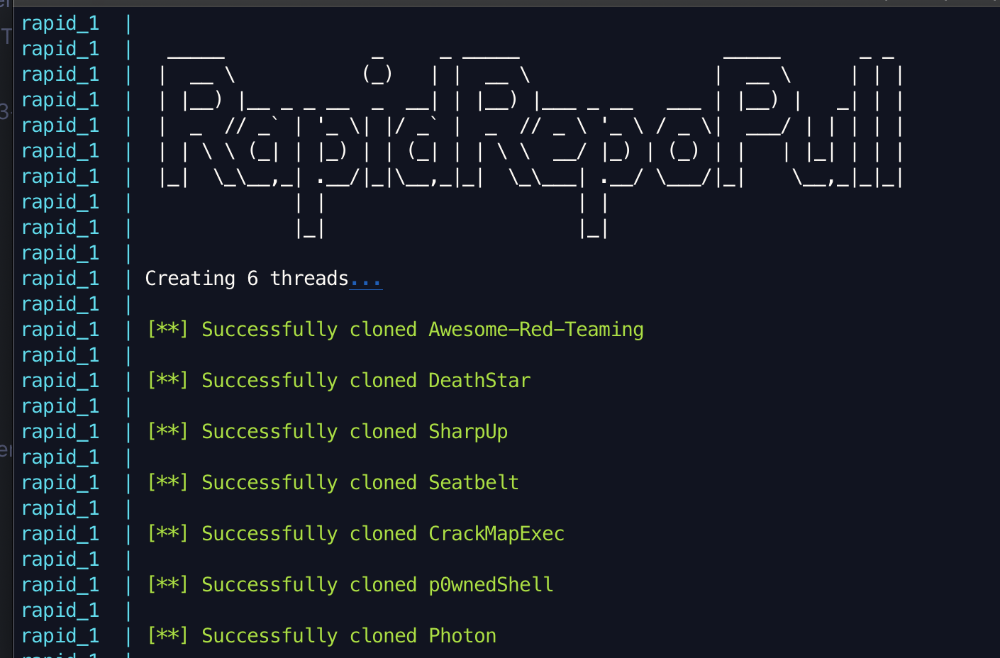

# RapidRepoPull


[](https://twitter.com/xtbalz)
[](https://www.codefactor.io/repository/github/tbalz2319/rapidrepopull)
[](https://github.com/tbalz2319/RapidRepoPull/actions/workflows/tests.yml)



## Created and Maintained by

- Talal Balouch (Twitter @xtbalz)

## Description

RapidRepoPull clones and maintains a curated list of security repositories in
parallel. Point it at the bundled list, your own text file, or any web page full
of GitHub links, and it will clone everything at once -- then fast-forward it all
later with a single `--update`.

It is particularly useful for the corpus repositories that no package manager
covers: SecLists, PayloadsAllTheThings, Yara rules, payload collections and
awesome-lists, which go stale silently and are tedious to refresh by hand.

It also knows when its own list has rotted. `--doctor` checks every entry
against GitHub and reports what has been renamed, archived or deleted, and
`--fix` writes the answers back.

## Requirements

- Python 3.9 or newer
- `git` on your PATH

    ```sudo apt-get install git python3-venv```

## Install

```bash
git clone https://github.com/tbalz2319/RapidRepoPull.git
cd RapidRepoPull
pip install .
```

This puts two identical commands on your PATH: `rapidrepopull` and the short
alias `rrp`.

To install into a virtualenv instead, run `./arm.sh`, which creates `venv/`,
installs the package and tells you how to activate it.

## Usage

```
Usage: rapidrepopull [OPTIONS]

Options:
  -v, --verbose                   Print detailed progress and timings.
  -f, --file, --fileinput FILE    Text file listing repositories to clone
                                  [default: the bundled list]
  -u, --url TEXT                  Scrape a web page for repository links.
  -t, --threads, --thread INTEGER Concurrent git processes (1-64).  [default: 16]
  -o, --output-dir DIRECTORY      Directory to clone into.  [default: repos]
  --depth INTEGER                 Shallow clones with this history depth.
  --ssh                           Clone over SSH instead of HTTPS.
  --update / --no-update          Fast-forward what is already present.  [default: update]
  --timeout INTEGER               Seconds before a git operation is abandoned.  [default: 600]
  --retries INTEGER               Extra attempts for network failures.  [default: 2]
  --tag TAG                       Only handle repositories with this tag.
  --list-tags                     Print the tags the list defines, and exit.
  --install                       After cloning, build repositories that declare how.
  --doctor                        Check every entry against GitHub, then exit.
  --fix                           With --doctor, write the findings back to the list.
  --stale-days DAYS               With --doctor, flag repos idle this long.  [default: 730]
  --prune                         Remove clones whose entries left the list.
  -y, --yes                       Answer yes to confirmation prompts.
  --no-manifest                   Do not write .rapidrepopull.json.
  -n, --dry-run                   List what would be done and exit.
  --save-list FILE                Write the resolved repository list to this file.
  --insecure                      Skip TLS verification when scraping.
  --no-banner                     Suppress the ASCII art header.
  -V, --version                   Show the version and exit.
  -h, --help                      Show this message and exit.
```

### Examples

Clone the bundled list into `./repos`:

```bash
rapidrepopull
```

Shallow clones, which is dramatically faster and smaller (SecLists alone is
over a gigabyte with full history):

```bash
rapidrepopull --depth 1
```

Use your own list, 32 clones at a time:

```bash
rapidrepopull -f mytools.txt -t 32
```

Refresh everything already cloned:

```bash
rapidrepopull --update
```

Scrape a page and clone every repository it links to:

```bash
rapidrepopull -v -u https://apsdehal.in/awesome-ctf
```

See what would happen without touching the disk:

```bash
rapidrepopull --dry-run
```

### Cloning a subset

The bundled list is 54 repositories and several gigabytes; you rarely want all
of it on one box. Entries are grouped into tags:

```bash
rapidrepopull --list-tags          # wordlists, recon, web, windows, c2, ...
rapidrepopull --tag recon,web      # just those two groups
```

### Checking the list for rot

Security tooling moves, gets archived, and disappears. `--doctor` asks GitHub
about every entry and says what it found:

```bash
rapidrepopull --doctor                    # report only
rapidrepopull --doctor -f my.txt --fix    # rewrite the list
```

Renames are repointed, deleted repositories are commented out, and archived or
long-dormant ones are annotated but left enabled -- dropping those is a curation
decision, not an automatic one. Comments, ordering and `@tag:` directives
survive the rewrite.

Unauthenticated GitHub allows 60 API calls an hour, which is fewer than the
list is long. Set `GITHUB_TOKEN` (or `RRP_GITHUB_TOKEN`) to raise it to 5000.
A weekly GitHub Actions workflow runs this check automatically.

### Keeping the output directory honest

Every run records what it cloned, and at which commit, in
`.rapidrepopull.json` inside the output directory. A later run reports only
the repositories that actually moved, and `--prune` offers to remove clones
whose entries have left the list:

```bash
rapidrepopull --update            # "Commits recorded: 3 updated"
rapidrepopull --prune             # asks before deleting
```

Pruning only ever considers directories the manifest says RapidRepoPull
created, and it compares against the whole list rather than the `--tag`
subset, so a tagged run cannot delete another tag's clones.

### Installing what it clones

`--install` is opt-in, and builds only repositories that declare how:

| Marker | What runs |
|---|---|
| `go.mod` | `go install ./...` |
| `pyproject.toml`, `setup.py` | `pipx install .` |
| `requirements.txt` | a virtualenv inside the clone, then `pip install -r` |
| `package.json` | `npm install --omit=dev`, inside the clone |

It deliberately does **not** run a repository's own `install.sh`. That is
arbitrary code from the internet, and running 54 of them unattended is a
supply-chain incident waiting to happen. Makefiles, cmake, gradle, maven, cargo
and Visual Studio projects are reported as needing manual steps rather than
guessed at, and pure-data repositories are reported as having nothing to build.

Note that the recipes above still execute code -- a `setup.py` or an npm
postinstall hook can do anything -- so treat `--install` as the trust decision
it is. `--install --dry-run` prints what would run without running it.

### Repository list format

One repository per line. Blank lines and `#` comments are ignored, and any of
these forms work:

```
owner/repo
https://github.com/owner/repo
https://github.com/owner/repo.git
git@github.com:owner/repo.git
```

A `# @tag: name` directive labels every repository after it until the next
directive, and a trailing comment tags one line on its own:

```
# @tag: recon
https://github.com/laramies/theHarvester
https://github.com/OJ/gobuster    # @tag: web
```

The bundled list lives at `rapidrepopull/data/default.txt`. A `default.txt` in
your working directory overrides it, or pass your own with `-f`.

## Docker

```bash
docker-compose up --build
```

Clones land in `./repos` on the host.

## Helper scripts

| Script | |
|---|---|
| `./install.sh` | create a venv, install, and run against the default list |
| `./arm.sh` | create a venv and install, without running |
| `./option4.sh` | create a venv, install, and print the options |
| `./update_repos.sh` | fast-forward everything already cloned |
| `./clean.sh` | remove the `repos/` directory (asks first) |

## Development

```bash
pip install -e '.[dev]'
pytest
ruff check .
```

## Contribute

- Pull requests welcomed
- Repositories that have moved or gone dead are the most useful fixes; the
  bundled list rots faster than the code does
